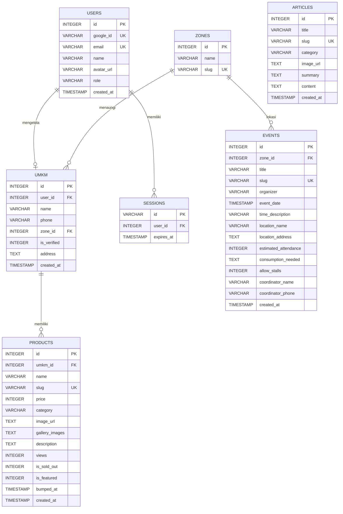

# Dokumentasi Skema Database (Neon PostgreSQL & SQLite)

Aplikasi **Pasar Warga NU Sumenep** mendukung dua mode database:
1. **Produksi (Cloud):** **Neon Serverless PostgreSQL** (Anti data-loss saat redeploy di Vercel, auto-wake up < 1s, tidak pernah di-pause).
2. **Pengembangan Lokal (Local Dev):** **SQLite** (`data/mamasar.db`) via `better-sqlite3`.

---

## 🗄️ Diagram Relasi Entitas (ERD)



---

## 📑 Spesifikasi Tabel Lengkap

### 1. Tabel `zones` (Wilayah MWC NU)
Menyimpan 11 wilayah administratif Majelis Wakil Cabang (MWC) NU se-Kabupaten Sumenep.

| Kolom | Tipe Data | Modifiers | Deskripsi |
| :--- | :--- | :--- | :--- |
| `id` | `INTEGER` | PRIMARY KEY AUTOINCREMENT | ID Unik Zona MWC |
| `name` | `TEXT` | NOT NULL | Nama MWC (contoh: *MWC Kota Sumenep*, *MWC Gapura*) |
| `slug` | `TEXT` | NOT NULL UNIQUE | URL Slug (contoh: `mwc-kota-sumenep`) |

---

### 2. Tabel `umkm` (Profil Penjual / Toko Warga)
Menyimpan profil entitas usaha warga Nahdliyin yang terverifikasi.

| Kolom | Tipe Data | Modifiers | Deskripsi |
| :--- | :--- | :--- | :--- |
| `id` | `INTEGER` | PRIMARY KEY AUTOINCREMENT | ID Toko / Usaha |
| `name` | `TEXT` | NOT NULL | Nama Usaha / Toko (contoh: *UD Barokah Jaya*) |
| `phone` | `TEXT` | NOT NULL | Nomor WhatsApp terstandarisasi (awalan `628xx`) |
| `zone_id` | `INTEGER` | NOT NULL REFERENCES zones(id) | Relasi ke MWC NU tempat domisili usaha |
| `is_verified` | `INTEGER` | DEFAULT 1 | 1 = Terverifikasi kader NU, 0 = Menunggu |
| `address` | `TEXT` | NULLABLE | Dusun/Desa atau alamat fisik toko |
| `created_at` | `DATETIME` | DEFAULT CURRENT_TIMESTAMP | Waktu pendaftaran |

---

### 3. Tabel `products` (Katalog Iklan Produk)
Unit barang/jasa yang diindeks oleh mesin pencari Google dan dipromosikan ke pembeli.

| Kolom | Tipe Data | Modifiers | Deskripsi |
| :--- | :--- | :--- | :--- |
| `id` | `INTEGER` | PRIMARY KEY AUTOINCREMENT | ID Iklan Produk |
| `umkm_id` | `INTEGER` | NOT NULL REFERENCES umkm(id) | Relasi ke pemilik UMKM |
| `name` | `TEXT` | NOT NULL | Nama Produk (contoh: *Rengginang Lorjuk Spesial*) |
| `slug` | `TEXT` | NOT NULL UNIQUE | SEO Slug unik (contoh: `rengginang-lorjuk-spesial-k7x8`) |
| `price` | `INTEGER` | NOT NULL | Harga jual satuan dalam Rupiah |
| `category` | `TEXT` | NOT NULL | Kategori produk dari `PRODUCT_CATEGORIES` |
| `image_url` | `TEXT` | NOT NULL | Path foto utama (`/uploads/...` atau URL web) |
| `gallery_images` | `TEXT` | NULLABLE | JSON string daftar URL foto sekunder |
| `description` | `TEXT` | NULLABLE | Deskripsi detail produk & spesifikasi |
| `views` | `INTEGER` | DEFAULT 50 | Jumlah klik pembeli melihat iklan ini |
| `is_sold_out` | `INTEGER` | DEFAULT 0 | 1 = Habis/Terjual, 0 = Tersedia |
| `is_featured` | `INTEGER` | DEFAULT 0 | 1 = Tampil di pilihan unggulan / banner |
| `bumped_at` | `DATETIME` | DEFAULT CURRENT_TIMESTAMP | Timestamp sundulan terakhir (mengatur urutan teratas) |
| `created_at` | `DATETIME` | DEFAULT CURRENT_TIMESTAMP | Waktu pertama terbit |

---

### 4. Tabel `articles` (Menu Edukasi & Panduan Usaha)
Artikel panduan bisnis santri, ekonomi pekarangan, serta tata cara transaksi warga.

| Kolom | Tipe Data | Modifiers | Deskripsi |
| :--- | :--- | :--- | :--- |
| `id` | `INTEGER` | PRIMARY KEY AUTOINCREMENT | ID Artikel |
| `title` | `TEXT` | NOT NULL | Judul artikel |
| `slug` | `TEXT` | NOT NULL UNIQUE | URL slug artikel |
| `category` | `TEXT` | NOT NULL | Kategori artikel (*Ekonomi Pekarangan*, *Panduan Usaha*) |
| `image_url` | `TEXT` | NOT NULL | Gambar banner artikel |
| `summary` | `TEXT` | NOT NULL | Ringkasan untuk card di homepage |
| `content` | `TEXT` | NOT NULL | Isi teks lengkap artikel (Markdown / HTML) |
| `created_at` | `DATETIME` | DEFAULT CURRENT_TIMESTAMP | Tanggal penerbitan |

---

### 5. Tabel `events` (Direktori Kegiatan NU & Pasar Konsumsi)
Jadwal pengajian, harlah, dan kegiatan NU yang membuka peluang pesanan katering serta lapak bazar warga.

| Kolom | Tipe Data | Modifiers | Deskripsi |
| :--- | :--- | :--- | :--- |
| `id` | `INTEGER` | PRIMARY KEY AUTOINCREMENT | ID Kegiatan |
| `zone_id` | `INTEGER` | NOT NULL REFERENCES zones(id) | Lokasi MWC tempat berlangsungnya acara |
| `title` | `TEXT` | NOT NULL | Nama Kegiatan (contoh: *Lailatul Ijtima' MWC Gapura*) |
| `slug` | `TEXT` | NOT NULL UNIQUE | URL slug kegiatan |
| `organizer` | `TEXT` | NOT NULL | Penyelenggara (contoh: *MWC NU Gapura & GP Ansor*) |
| `event_date` | `DATETIME` | NOT NULL | Tanggal pelaksanaan |
| `time_description` | `TEXT` | NOT NULL | Waktu (contoh: *19.30 WIB (Ba'da Isya) - Selesai*) |
| `location_name` | `TEXT` | NOT NULL | Nama tempat (contoh: *Gedung MWC NU Gapura*) |
| `location_address` | `TEXT` | NULLABLE | Alamat lengkap lokasi acara |
| `estimated_attendance` | `INTEGER` | DEFAULT 0 | Estimasi jumlah jamaah/peserta yang hadir |
| `consumption_needed` | `TEXT` | NULLABLE | Kebutuhan konsumsi panitia (snack box, nasi kotak) |
| `allow_stalls` | `INTEGER` | DEFAULT 1 | 1 = Warga boleh buka lapak jualan di lokasi |
| `coordinator_name` | `TEXT` | NULLABLE | Nama koordinator / seksi konsumsi panitia |
| `coordinator_phone` | `TEXT` | NOT NULL | Nomor WhatsApp koordinator acara |
| `created_at` | `DATETIME` | DEFAULT CURRENT_TIMESTAMP | Waktu posting agenda |

---

### 6. Tabel `users` (Akun Pengguna Google OAuth)
Menyimpan data identitas pemilik UMKM yang login via Google.

| Kolom | Tipe Data | Modifiers | Deskripsi |
| :--- | :--- | :--- | :--- |
| `id` | `INTEGER` / `SERIAL` | PRIMARY KEY | ID Pengguna |
| `google_id` | `VARCHAR(255)` | NOT NULL UNIQUE | Sub ID unik dari Google OAuth |
| `email` | `VARCHAR(255)` | NOT NULL UNIQUE | Alamat email Google pengguna |
| `name` | `VARCHAR(255)` | NOT NULL | Nama lengkap pemilik usaha |
| `avatar_url` | `TEXT` | NULLABLE | Foto profil dari Google |
| `role` | `VARCHAR(50)` | DEFAULT 'umkm' | Hak akses (`umkm`, `agent`, `admin`) |
| `created_at` | `TIMESTAMP` | DEFAULT CURRENT_TIMESTAMP | Waktu registrasi pertama |

---

### 7. Tabel `sessions` (Sesi Login Pengguna)
Menyimpan token sesi aktif untuk autentikasi browser berbasis cookie aman.

| Kolom | Tipe Data | Modifiers | Deskripsi |
| :--- | :--- | :--- | :--- |
| `id` | `VARCHAR(255)` | PRIMARY KEY | Token Sesi Acak Unik (UUIDv4) |
| `user_id` | `INTEGER` | NOT NULL REFERENCES users(id) | Relasi ke pemilik akun |
| `expires_at` | `TIMESTAMP` | NOT NULL | Waktu kedaluwarsa sesi |

---

## 🐘 DDL Skrip PostgreSQL untuk Neon Cloud (`schema.sql`)

Jalankan script ini di **Neon SQL Editor** untuk membuat tabel di cloud secara instan:

```sql
-- 1. Tabel Wilayah MWC
CREATE TABLE IF NOT EXISTS zones (
  id SERIAL PRIMARY KEY,
  name VARCHAR(255) NOT NULL,
  slug VARCHAR(255) NOT NULL UNIQUE
);

-- 2. Tabel Pengguna Google
CREATE TABLE IF NOT EXISTS users (
  id SERIAL PRIMARY KEY,
  google_id VARCHAR(255) NOT NULL UNIQUE,
  email VARCHAR(255) NOT NULL UNIQUE,
  name VARCHAR(255) NOT NULL,
  avatar_url TEXT,
  role VARCHAR(50) DEFAULT 'umkm',
  created_at TIMESTAMP WITH TIME ZONE DEFAULT CURRENT_TIMESTAMP
);

-- 3. Tabel Sesi Login
CREATE TABLE IF NOT EXISTS sessions (
  id VARCHAR(255) PRIMARY KEY,
  user_id INTEGER NOT NULL REFERENCES users(id) ON DELETE CASCADE,
  expires_at TIMESTAMP WITH TIME ZONE NOT NULL
);

-- 4. Tabel Toko UMKM
CREATE TABLE IF NOT EXISTS umkm (
  id SERIAL PRIMARY KEY,
  user_id INTEGER REFERENCES users(id) ON DELETE SET NULL,
  name VARCHAR(255) NOT NULL,
  phone VARCHAR(50) NOT NULL,
  zone_id INTEGER NOT NULL REFERENCES zones(id),
  is_verified INTEGER DEFAULT 1,
  address TEXT,
  created_at TIMESTAMP WITH TIME ZONE DEFAULT CURRENT_TIMESTAMP
);

-- 5. Tabel Produk
CREATE TABLE IF NOT EXISTS products (
  id SERIAL PRIMARY KEY,
  umkm_id INTEGER NOT NULL REFERENCES umkm(id) ON DELETE CASCADE,
  name VARCHAR(255) NOT NULL,
  slug VARCHAR(255) NOT NULL UNIQUE,
  price INTEGER NOT NULL,
  category VARCHAR(100) NOT NULL,
  image_url TEXT NOT NULL,
  gallery_images TEXT,
  description TEXT,
  views INTEGER DEFAULT 50,
  is_sold_out INTEGER DEFAULT 0,
  is_featured INTEGER DEFAULT 0,
  bumped_at TIMESTAMP WITH TIME ZONE DEFAULT CURRENT_TIMESTAMP,
  created_at TIMESTAMP WITH TIME ZONE DEFAULT CURRENT_TIMESTAMP
);

-- 6. Tabel Artikel Edukasi
CREATE TABLE IF NOT EXISTS articles (
  id SERIAL PRIMARY KEY,
  title VARCHAR(255) NOT NULL,
  slug VARCHAR(255) NOT NULL UNIQUE,
  category VARCHAR(100) NOT NULL,
  image_url TEXT NOT NULL,
  summary TEXT NOT NULL,
  content TEXT,
  created_at TIMESTAMP WITH TIME ZONE DEFAULT CURRENT_TIMESTAMP
);

-- 7. Tabel Kegiatan NU
CREATE TABLE IF NOT EXISTS events (
  id SERIAL PRIMARY KEY,
  zone_id INTEGER NOT NULL REFERENCES zones(id),
  title VARCHAR(255) NOT NULL,
  slug VARCHAR(255) NOT NULL UNIQUE,
  organizer VARCHAR(255) NOT NULL,
  event_date TIMESTAMP WITH TIME ZONE NOT NULL,
  time_description VARCHAR(255) NOT NULL,
  location_name VARCHAR(255) NOT NULL,
  location_address TEXT,
  estimated_attendance INTEGER DEFAULT 0,
  consumption_needed TEXT,
  allow_stalls INTEGER DEFAULT 1,
  coordinator_name VARCHAR(255),
  coordinator_phone VARCHAR(50) NOT NULL,
  created_at TIMESTAMP WITH TIME ZONE DEFAULT CURRENT_TIMESTAMP
);

-- Indeks Pencarian Cepat
CREATE INDEX IF NOT EXISTS idx_products_category ON products(category);
CREATE INDEX IF NOT EXISTS idx_products_bumped ON products(bumped_at DESC);
CREATE INDEX IF NOT EXISTS idx_umkm_zone ON umkm(zone_id);
```
} catch (_) {}
```
