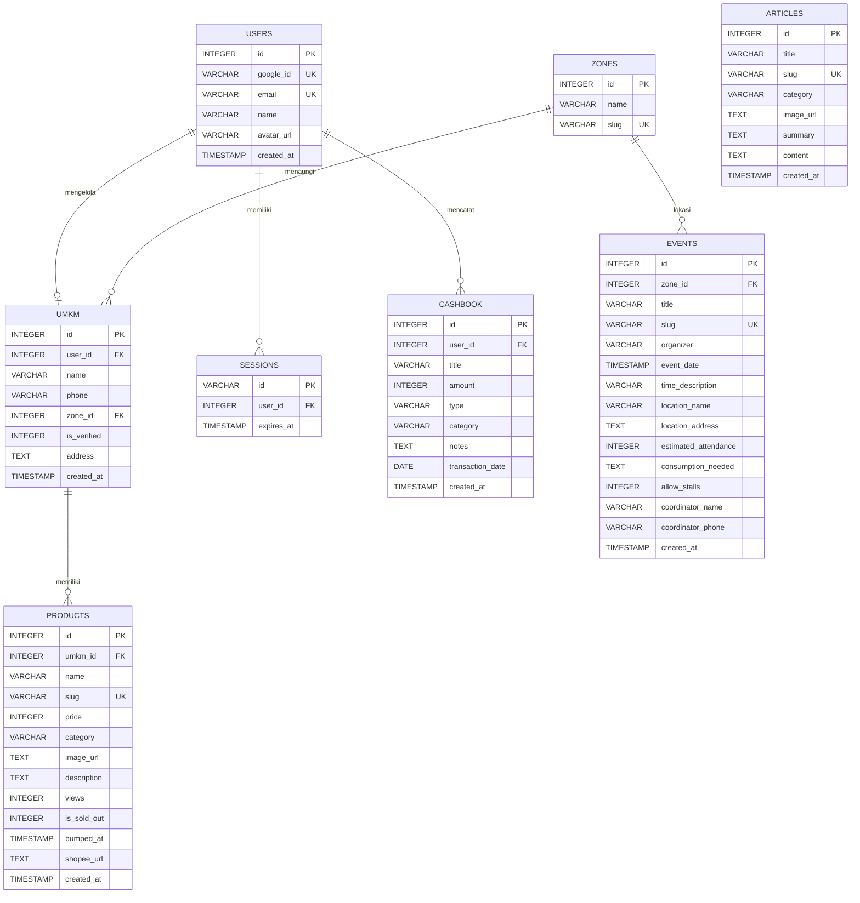

# Dokumentasi Skema Database (Neon PostgreSQL)

Aplikasi **Pasar Warga NU Sumenep** memakai **Neon PostgreSQL** sebagai database tunggal:

1. **Neon PostgreSQL (satu-satunya database)**: `src/lib/db.ts` menjalankan semua operasi baca/tulis halaman dan API lewat Drizzle ORM (`drizzle-orm/neon-http`) di atas driver serverless `@neondatabase/serverless` dengan `DATABASE_URL`. Semua fungsi bersifat async; definisi tabel ada di `src/lib/schema.ts`.

Skema dan seed cloud dikelola lewat `scripts/migrate-neon.js`. Jalur SQLite era awal (skrip seed/backup, `better-sqlite3`) sudah dihapus.

---

## Diagram Relasi Entitas (ERD)



---

## Spesifikasi Tabel

### 1. Tabel `zones` (Wilayah MWC NU)

Menyimpan 27 wilayah Majelis Wakil Cabang (MWC) NU se-Kabupaten Sumenep: 18 MWC daratan dan 9 MWC kepulauan. Daftar lengkap ada di `SEED_ZONES` pada `src/lib/seeds.ts`.

| Kolom | Tipe Data | Modifiers | Deskripsi |
| :--- | :--- | :--- | :--- |
| `id` | `INTEGER` | PRIMARY KEY AUTOINCREMENT | ID unik zona MWC |
| `name` | `TEXT` | NOT NULL | Nama MWC (contoh: `MWC Kota Sumenep`, `MWC Gapura`) |
| `slug` | `TEXT` | NOT NULL UNIQUE | Slug URL (contoh: `mwc-kota-sumenep`) |

---

### 2. Tabel `umkm` (Profil Penjual / Toko Warga)

| Kolom | Tipe Data | Modifiers | Deskripsi |
| :--- | :--- | :--- | :--- |
| `id` | `INTEGER` | PRIMARY KEY AUTOINCREMENT | ID toko / usaha |
| `user_id` | `INTEGER` | NULLABLE REFERENCES users(id) | Akun pemilik toko. `NULL` untuk data hasil pendataan agen — penjual yang kemudian mendaftar dengan nomor WhatsApp sama dapat mengambil alih toko via `/api/umkm/setup` (lihat `DOCS/API.md`) |
| `name` | `TEXT` | NOT NULL | Nama usaha / toko |
| `phone` | `TEXT` | NOT NULL | Nomor WhatsApp terstandardisasi (`628xx`) |
| `zone_id` | `INTEGER` | NOT NULL REFERENCES zones(id) | Relasi ke MWC tempat domisili usaha |
| `is_verified` | `INTEGER` | DEFAULT 1 | 1 = terverifikasi (seed LPNU, atau diaktifkan pengurus MWC), 0 = menunggu verifikasi pengurus. Semua pendaftaran oleh pengguna — dashboard maupun `/agen` — selalu membuat 0 |
| `address` | `TEXT` | NULLABLE | Dusun/desa atau alamat fisik toko |
| `created_at` | `DATETIME` | DEFAULT CURRENT_TIMESTAMP | Waktu pendaftaran |

---

### 3. Tabel `products` (Katalog Iklan Produk)

| Kolom | Tipe Data | Modifiers | Deskripsi |
| :--- | :--- | :--- | :--- |
| `id` | `INTEGER` | PRIMARY KEY AUTOINCREMENT | ID iklan produk |
| `umkm_id` | `INTEGER` | NOT NULL REFERENCES umkm(id) | Relasi ke pemilik UMKM |
| `name` | `TEXT` | NOT NULL | Nama produk |
| `slug` | `TEXT` | NOT NULL UNIQUE | Slug SEO unik (contoh: `rengginang-lorjuk-spesial-k7x8`) |
| `price` | `INTEGER` | NOT NULL | Harga jual satuan dalam Rupiah |
| `category` | `TEXT` | NOT NULL | Salah satu nilai `PRODUCT_CATEGORIES` di `src/lib/constants.ts` |
| `image_url` | `TEXT` | NOT NULL | URL foto utama (ImageKit, `/uploads/...`, atau URL web) |
| `description` | `TEXT` | NULLABLE | Deskripsi detail produk |
| `views` | `INTEGER` | DEFAULT 0 | Jumlah tampilan halaman produk (increment saat kunjungan unik) |
| `is_sold_out` | `INTEGER` | DEFAULT 0 | 1 = habis/terjual, 0 = tersedia |
| `bumped_at` | `DATETIME` | DEFAULT CURRENT_TIMESTAMP | Waktu sundulan terakhir. Menentukan urutan katalog |
| `shopee_url` | `TEXT` | NULLABLE | Tautan produk di Shopee, opsional |
| `created_at` | `DATETIME` | DEFAULT CURRENT_TIMESTAMP | Waktu pertama terbit |

Kolom `gallery_images` dan `is_featured` pernah dibuat di DDL awal tetapi tidak pernah dipakai aplikasi; keduanya dihapus dari skema (migrasi menjalankan `ALTER TABLE ... DROP COLUMN IF EXISTS`).

---

### 4. Tabel `articles` (Menu Edukasi & Panduan Usaha)

| Kolom | Tipe Data | Modifiers | Deskripsi |
| :--- | :--- | :--- | :--- |
| `id` | `INTEGER` | PRIMARY KEY AUTOINCREMENT | ID artikel |
| `title` | `TEXT` | NOT NULL | Judul artikel |
| `slug` | `TEXT` | NOT NULL UNIQUE | Slug URL artikel |
| `category` | `TEXT` | NOT NULL | Kategori artikel |
| `image_url` | `TEXT` | NOT NULL | Gambar banner artikel |
| `summary` | `TEXT` | NOT NULL | Ringkasan untuk card di beranda |
| `content` | `TEXT` | NULLABLE | Isi lengkap artikel |
| `created_at` | `DATETIME` | DEFAULT CURRENT_TIMESTAMP | Tanggal terbit |

---

### 5. Tabel `events` (Direktori Kegiatan NU & Pasar Konsumsi)

| Kolom | Tipe Data | Modifiers | Deskripsi |
| :--- | :--- | :--- | :--- |
| `id` | `INTEGER` | PRIMARY KEY AUTOINCREMENT | ID kegiatan |
| `zone_id` | `INTEGER` | NOT NULL REFERENCES zones(id) | Lokasi MWC acara |
| `title` | `TEXT` | NOT NULL | Nama kegiatan |
| `slug` | `TEXT` | NOT NULL UNIQUE | Slug URL kegiatan |
| `organizer` | `TEXT` | NOT NULL | Penyelenggara |
| `event_date` | `DATETIME` | NOT NULL | Tanggal pelaksanaan |
| `time_description` | `TEXT` | NOT NULL | Keterangan waktu (contoh: `19.30 WIB (Ba'da Isya) - Selesai`) |
| `location_name` | `TEXT` | NOT NULL | Nama tempat |
| `location_address` | `TEXT` | NULLABLE | Alamat lengkap lokasi |
| `estimated_attendance` | `INTEGER` | DEFAULT 0 | Estimasi jumlah jamaah |
| `consumption_needed` | `TEXT` | NULLABLE | Kebutuhan konsumsi panitia |
| `allow_stalls` | `INTEGER` | DEFAULT 1 | 1 = warga boleh membuka lapak |
| `coordinator_name` | `TEXT` | NULLABLE | Nama koordinator / seksi konsumsi |
| `coordinator_phone` | `TEXT` | NOT NULL | Nomor WhatsApp koordinator |
| `created_at` | `DATETIME` | DEFAULT CURRENT_TIMESTAMP | Waktu posting agenda |

---

### 6. Tabel `users` (Akun Pengguna)

| Kolom | Tipe Data | Modifiers | Deskripsi |
| :--- | :--- | :--- | :--- |
| `id` | `INTEGER` | PRIMARY KEY | ID pengguna |
| `google_id` | `TEXT` | NOT NULL UNIQUE | Identitas eksternal. Untuk Neon Auth diisi `neon_<user_id>` |
| `email` | `TEXT` | NOT NULL UNIQUE | Alamat email |
| `name` | `TEXT` | NOT NULL | Nama lengkap |
| `avatar_url` | `TEXT` | NULLABLE | Foto profil — URL http(s) (mis. foto Google) atau *key* objek Neon Object Storage (`avatars/...`) yang di-presign saat render |
| `role` | `VARCHAR(20)` | NOT NULL DEFAULT `'warga'` | `'warga'` = pengguna biasa; `'pengurus'` = boleh membuka `/pengurus` (verifikasi/cabut/hapus toko). Promosi dilakukan manual lewat SQL console |
| `created_at` | `DATETIME` | DEFAULT CURRENT_TIMESTAMP | Waktu registrasi pertama |

**Mempromosi pengurus MWC** (tidak ada UI-nya — sengaja, agar hak verifikasi tidak bisa dinaikkan lewat aplikasi):

```sql
UPDATE users SET role = 'pengurus' WHERE email = 'nama@nu.or.id';
```

Setelah login, pengurus melihat banner "Panel Pengurus MWC" di `/dashboard` yang menuju `/pengurus`.

---

### 7. Tabel `sessions` (Sesi Login Aplikasi)

Sesi lokal yang dibuat aplikasi setelah login Neon Auth atau OAuth Google. Sesi asli Neon Auth disimpan di luar database aplikasi. Sesi kedaluwarsa dibersihkan otomatis (janitor probabilistik saat `createSession`).

| Kolom | Tipe Data | Modifiers | Deskripsi |
| :--- | :--- | :--- | :--- |
| `id` | `TEXT` | PRIMARY KEY | Token sesi acak |
| `user_id` | `INTEGER` | NOT NULL REFERENCES users(id) | Pemilik akun |
| `expires_at` | `DATETIME` | NOT NULL | Waktu kedaluwarsa (30 hari) |

---

### 8. Tabel `cashbook` (Buku Kas Penjualan)

| Kolom | Tipe Data | Modifiers | Deskripsi |
| :--- | :--- | :--- | :--- |
| `id` | `INTEGER` | PRIMARY KEY AUTOINCREMENT | ID catatan |
| `user_id` | `INTEGER` | NOT NULL REFERENCES users(id) ON DELETE CASCADE | Pemilik catatan |
| `title` | `TEXT` | NOT NULL | Judul transaksi |
| `amount` | `INTEGER` | NOT NULL | Nominal dalam Rupiah, selalu positif |
| `type` | `TEXT` | NOT NULL DEFAULT `'income'` | `income` atau `expense` |
| `category` | `TEXT` | DEFAULT `'Penjualan'` | Kategori transaksi |
| `notes` | `TEXT` | NULLABLE | Catatan tambahan |
| `transaction_date` | `DATE` | DEFAULT `DATE('now')` | Tanggal transaksi |
| `created_at` | `DATETIME` | DEFAULT CURRENT_TIMESTAMP | Waktu pencatatan |

---

## DDL PostgreSQL untuk Neon (`schema.sql`)

Jalankan di Neon SQL Editor, atau pakai `scripts/migrate-neon.js` yang membuat tabel sekaligus melakukan seed.

```sql
CREATE TABLE IF NOT EXISTS zones (
  id SERIAL PRIMARY KEY,
  name VARCHAR(255) NOT NULL,
  slug VARCHAR(255) NOT NULL UNIQUE
);

CREATE TABLE IF NOT EXISTS users (
  id SERIAL PRIMARY KEY,
  google_id VARCHAR(255) NOT NULL UNIQUE,
  email VARCHAR(255) NOT NULL UNIQUE,
  name VARCHAR(255) NOT NULL,
  avatar_url TEXT,
  role VARCHAR(20) NOT NULL DEFAULT 'warga',
  created_at TIMESTAMP WITH TIME ZONE DEFAULT CURRENT_TIMESTAMP
);

CREATE TABLE IF NOT EXISTS sessions (
  id VARCHAR(255) PRIMARY KEY,
  user_id INTEGER NOT NULL REFERENCES users(id) ON DELETE CASCADE,
  expires_at TIMESTAMP WITH TIME ZONE NOT NULL
);

CREATE TABLE IF NOT EXISTS umkm (
  id SERIAL PRIMARY KEY,
  user_id INTEGER REFERENCES users(id) ON DELETE SET NULL,
  name VARCHAR(255) NOT NULL,
  phone VARCHAR(50) NOT NULL,
  zone_id INTEGER NOT NULL REFERENCES zones(id),
  is_verified INTEGER DEFAULT 1,
  address TEXT,
  created_at TIMESTAMP WITH TIME ZONE DEFAULT CURRENT_TIMESTAMP
);

CREATE TABLE IF NOT EXISTS products (
  id SERIAL PRIMARY KEY,
  umkm_id INTEGER NOT NULL REFERENCES umkm(id) ON DELETE CASCADE,
  name VARCHAR(255) NOT NULL,
  slug VARCHAR(255) NOT NULL UNIQUE,
  price INTEGER NOT NULL,
  category VARCHAR(100) NOT NULL,
  image_url TEXT NOT NULL,
  description TEXT,
  views INTEGER DEFAULT 0,
  is_sold_out INTEGER DEFAULT 0,
  bumped_at TIMESTAMP WITH TIME ZONE DEFAULT CURRENT_TIMESTAMP,
  shopee_url TEXT,
  created_at TIMESTAMP WITH TIME ZONE DEFAULT CURRENT_TIMESTAMP
);

CREATE TABLE IF NOT EXISTS articles (
  id SERIAL PRIMARY KEY,
  title VARCHAR(255) NOT NULL,
  slug VARCHAR(255) NOT NULL UNIQUE,
  category VARCHAR(100) NOT NULL,
  image_url TEXT NOT NULL,
  summary TEXT NOT NULL,
  content TEXT,
  created_at TIMESTAMP WITH TIME ZONE DEFAULT CURRENT_TIMESTAMP
);

CREATE TABLE IF NOT EXISTS events (
  id SERIAL PRIMARY KEY,
  zone_id INTEGER NOT NULL REFERENCES zones(id),
  title VARCHAR(255) NOT NULL,
  slug VARCHAR(255) NOT NULL UNIQUE,
  organizer VARCHAR(255) NOT NULL,
  event_date TIMESTAMP WITH TIME ZONE NOT NULL,
  time_description VARCHAR(255) NOT NULL,
  location_name VARCHAR(255) NOT NULL,
  location_address TEXT,
  estimated_attendance INTEGER DEFAULT 0,
  consumption_needed TEXT,
  allow_stalls INTEGER DEFAULT 1,
  coordinator_name VARCHAR(255),
  coordinator_phone VARCHAR(50) NOT NULL,
  created_at TIMESTAMP WITH TIME ZONE DEFAULT CURRENT_TIMESTAMP
);

CREATE TABLE IF NOT EXISTS cashbook (
  id SERIAL PRIMARY KEY,
  user_id INTEGER NOT NULL REFERENCES users(id) ON DELETE CASCADE,
  title VARCHAR(255) NOT NULL,
  amount INTEGER NOT NULL,
  type VARCHAR(20) NOT NULL DEFAULT 'income',
  category VARCHAR(100) DEFAULT 'Penjualan',
  notes TEXT,
  transaction_date DATE DEFAULT CURRENT_DATE,
  created_at TIMESTAMP WITH TIME ZONE DEFAULT CURRENT_TIMESTAMP
);

CREATE INDEX IF NOT EXISTS idx_cashbook_user ON cashbook(user_id, transaction_date DESC);
```

---

## Sinkronisasi skema

`scripts/migrate-neon.js` (DDL), `src/lib/schema.ts` (mirror Drizzle), dan `src/lib/db.ts` (query) sudah sinkron untuk tabel: `zones`, `umkm`, `products` (termasuk `shopee_url`, `views` default 0), `articles`, `events`, `users`, `sessions`, `cashbook` + index `idx_cashbook_user`. Saat mengubah DDL di `migrate-neon.js`, ubah juga `schema.ts` agar tetap sejajar.

Kolom yang pernah dibuat lalu dihapus karena tidak pernah dipakai aplikasi: `products.gallery_images`, `products.is_featured`, `users.role`. Migrasi menjalankan `DROP COLUMN IF EXISTS` untuk membersihkan database lama.

---

## Perintah database

```bash
# Buat skema dan seed Neon Postgres (jalur utama)
DATABASE_URL="postgresql://..." node scripts/migrate-neon.js

# Uji baca/tulis seluruh fungsi db.ts terhadap Neon (membersihkan datanya sendiri)
set -a && . ./.env && set +a && npx tsx scripts/db-smoke.mjs

# Uji siklus avatar (upload key → presign render) terhadap Neon Object Storage
set -a && . ./.env && set +a && npx tsx scripts/avatar-smoke.mjs
```

Skrip migrasi mengimpor `src/lib/seeds.ts` langsung, jadi butuh Node 22.18+ atau Node 24.

Runtime aplikasi WAJIB `DATABASE_URL`; tanpa itu semua query gagal dengan error eksplisit (`getNeonSql()` throw). Skrip SQLite era awal (`seed.js`, `backup.js`, dependency `better-sqlite3`) sudah dihapus.
