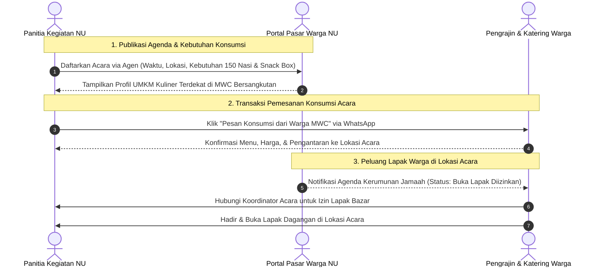

# Konsep Bisnis & Alur: Direktori Kegiatan NU sebagai Pasar Konsumsi & Lapak Warga

Dokumen ini menjelaskan rancangan arsitektur fungsional untuk modul **Kegiatan NU** di platform Pasar Warga NU Sumenep.

---

## 💡 Filosofi Dasar

> *"Di mana ada kegiatan Nahdlatul Ulama, di situ selalu ada hidangan dan kerumunan jamaah. Setiap kegiatan NU pada hakikatnya adalah pasar ekonomi riil bagi warga sekitar."*

Kegiatan NU di Kabupaten Sumenep berlangsung secara rutin dan berjenjang:
* **Lailatul Ijtima'** (rutin bulanan per MWC dan Ranting).
* **Majelis Diba'an & Tahlil Jamaah** (rutin mingguan).
* **Konfercab / Konferancab / Musker** (tahunan).
* **Peringatan Hari Besar Islam & Harlah NU / Banom** (Ansor, Fatayat, Muslimat, IPNU-IPPNU).

Setiap acara selalu menghasilkan dua arus transaksi nyata:
1. **Belanja Panitia (Pengeluaran Konsumsi)**: Membutuhkan puluhan hingga ratusan porsi nasi kotak, tumpeng, kue basah/snack box, kopi, dan air mineral kemasan.
2. **Belanja Jamaah (Kerumunan Pembeli)**: Ratusan jamaah yang berkumpul membeli camilan, minuman dingin, kopyah, tasbih, minyak wangi, batik, atau hasil bumi dari lapak pedagang yang mangkal di lokasi.

---

## 🔄 Alur Dua Arah (Two-Sided Marketplace Workflow)

---

## 📱 Rancangan Antarmuka Pengguna (UI Wireframe Concept)

### A. Pada Halaman Detail Acara (`/kegiatan/[slug]`)
1. **Header Acara**:
   - Nama Acara: *"Lailatul Ijtima' MWC NU Ambunten"*
   - Penyelenggara: *"MWC NU Ambunten & PAC GP Ansor"*
   - Tanggal & Waktu: *"Malam Ahad, 15 November 2026 • 19.30 WIB"*
   - Tempat: *"Halaman Masjid Jami' Ambunten"*
   - Estimasi Jamaah: *~250 Jamaah*
2. **Blok Kebutuhan Konsumsi Panitia**:
   - Catatan Panitia: *"Dibutuhkan 200 snack box kue tradisional dan 50 porsi nasi bungkus untuk jamuan penceramah dan jamaah."*
   - Tombol Aksi Utama:
     `[ 🍲 Pesan Konsumsi Acara dari UMKM MWC Ambunten ]`
     *(Mengklik tombol ini langsung memfilter katalog kuliner khusus MWC Ambunten).*
3. **Blok Peluang Buka Lapak Bazar**:
   - Badge: `✅ Warga & Santri Diizinkan Membuka Lapak Jualan`
   - Tombol Kontak Koordinator Lapak:
     `[ 💬 Hubungi Koordinator Bazar via WhatsApp ]`

### B. Pada Halaman Profil UMKM Kuliner (`/toko/[id]`)
- Menampilkan badge layanan:
  `[ 🍱 Siap Melayani Pesanan Nasi Kotak & Snack Acara NU ]`

---

## 🎯 Dampak Sosial & Ekonomi
1. **Uang Jamaah Berputar di Lingkaran Sendiri**: Anggaran konsumsi acara dari infaq warga tidak lari ke katering luar, melainkan kembali menghidupkan dapur keluarga Nahdliyin.
2. **Kualitas & Kehalalan Terjamin**: Makanan dimasak oleh tangan warga NU sendiri yang memahami adab thoharoh dan kehalalan bahan.
3. **Pemberdayaan Nyata Banom Perempuan**: Membuka pasar rutin bagi kader Muslimat dan Fatayat yang memiliki usaha boga rumahan.
