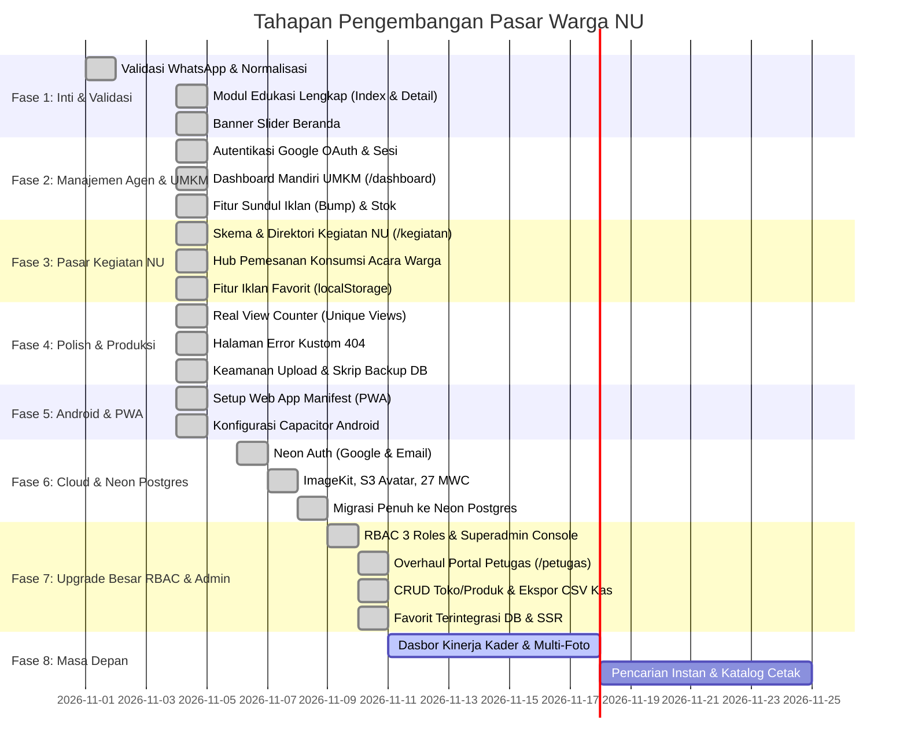

# Roadmap Pengembangan: Pasar Warga NU Sumenep (Mamasar)

Dokumen ini memetakan rencana kerja pengembangan aplikasi **Direktori Digital UMKM Nahdliyin Kabupaten Sumenep** menuju status aplikasi yang utuh, mandiri, dan siap skala operasional.

---

## 🧭 Prinsip Utama Arsitektur

1. **Nol Hambatan Operasional (Zero Operational Friction)**: UMKM tidak dibebani proses login yang rumit atau dashboard yang berbelit-belit. Konversi 100% langsung via pesan WhatsApp terstruktur tanpa potongan komisi perantara.
2. **Jemput Bola Kader Pendata Lapangan**: Pendataan digerakkan oleh kader lapangan MWC NU via portal `/petugas` dengan alur verifikasi resmi dan kompresi foto otomatis di sisi klien.
3. **Ekonomi Jamaah Nyata**: Mengintegrasikan kegiatan NU (pengajian akbar, Lailatul Ijtima', Harlah) sebagai pasar konsumsi (katering/snack berkat) dan peluang lapak bazar warga.
4. **100% SEO-Friendly & Mobile-First**: Performa tinggi, data terstruktur Schema.org, Open Graph lengkap, dan waktu muat instan di jaringan internet pelosok desa dan kepulauan Sumenep.
5. **Skalabilitas Cloud Modern**: Menggunakan Neon PostgreSQL serverless dengan Drizzle ORM, CDN ImageKit, serta integrasi PWA dan native Android (Capacitor).

---

## 📌 Status Pelaksanaan per Fase

---

## 📋 Rincian Pekerjaan & Checklist

### Fase 1: Kebutuhan Inti & Validasi Data - [SELESAI ✅]
- [x] **1.1. Validasi Nomor WhatsApp & Normalisasi Otomatis**
  - [x] Regex validasi nomor HP Indonesia (`08xx`, `628xx`, panjang 10-14 digit) di `src/lib/utils.ts`.
  - [x] Validasi interaktif langsung pada form input toko dan produk.
  - [x] Validasi ketat di endpoint API `src/pages/api/products.ts` (tolak nomor palsu).
- [x] **1.2. Modul Edukasi & Panduan Usaha Lengkap**
  - [x] Kolom `content TEXT` pada tabel `articles` di Drizzle ORM.
  - [x] Konten panduan usaha: Ekonomi Pekarangan, Panduan Usaha Santri, dan Sertifikasi Halal Gratis SEHATI BPJPH.
  - [x] Halaman katalog artikel `src/pages/edukasi/index.astro`.
  - [x] Halaman baca detail `src/pages/edukasi/[slug].astro` dengan Open Graph & Schema.org Article.
  - [x] Hubungkan card artikel di beranda dan navigasi drawer ke rute edukasi.
- [x] **1.3. Banner Slider Interaktif di Beranda**
  - [x] Komponen `src/components/PromoSlider.astro` (CSS scroll-snap murni, tanpa library berat).
  - [x] Konten slide: Kampanye Belanja Produk Tetangga, Sorotan Batik Tulis Sumenep, dan Konsultasi Usaha Santri.

---

### Fase 2: Autentikasi Google, Unggah Mandiri UMKM & Manajemen Iklan - [SELESAI ✅]
- [x] **2.1. Autentikasi Google OAuth 2.0 & Profil Mandiri**
  - [x] Endpoint `/api/auth/login` dan `/api/auth/callback/google` (verifikasi profil Google & buat session cookie aman).
  - [x] Form penyiapan identitas toko pertama kali login.
- [x] **2.2. Dashboard Toko Mandiri UMKM (`/dashboard`)**
  - [x] Tampilan ringkasan performa toko (nama toko, wilayah MWC, total produk aktif).
  - [x] Form tambah produk mandiri dengan kompresor foto HP otomatis di browser.
  - [x] Fitur edit produk, toggle status stok (*Tersedia / Habis*), dan hapus iklan.
- [x] **2.3. Fitur "Naikkan Iklan" (Sundul / Bump to Featured)**
  - [x] Kolom `is_featured` dan `bumped_at` pada tabel `products`.
  - [x] Tombol **⚡ Sundul Iklan** di dashboard UMKM & endpoint `/api/products/bump` untuk mereset urutan tayang teratas.
  - [x] Urutan katalog default: `ORDER BY COALESCE(p.bumped_at, p.created_at) DESC, p.id DESC`.
- [x] **2.4. Penanganan Klaim Toko Hasil Pendataan Lapangan**
  - [x] Penjual yang mendaftar via `/dashboard` dengan nomor WhatsApp yang sama ditawari mengambil alih toko hasil pendataan kader (`created_by_user_id` / orphan store) alih-alih membuat toko duplikat.

---

### Fase 3: Pasar Kegiatan NU & Komunitas - [SELESAI ✅]
- [x] **3.1. Direktori Kegiatan NU sebagai Hub Konsumsi & Pasar (`/kegiatan`)**
  - [x] Tabel `events` di Neon Postgres (penyelenggara MWC/Banom, tanggal, lokasi, estimasi jamaah, catatan konsumsi, status lapak bazar).
  - [x] Halaman agenda kegiatan `src/pages/kegiatan/index.astro`.
  - [x] Halaman detail kegiatan `src/pages/kegiatan/[slug].astro` dengan tombol pesan katering ke UMKM terdekat dan pendaftaran lapak bazar.
  - [x] Panel pengurus & superadmin di `/kegiatan` untuk publikasi dan moderasi agenda.
- [x] **3.2. Fitur Simpan Iklan Favorit (Bookmark)**
  - [x] Tombol bintang interaktif di seluruh kartu katalog dan halaman produk.
  - [x] Halaman `src/pages/favorit.astro`.

---

### Fase 4: Polish Produksi & Keamanan - [SELESAI ✅]
- [x] **4.1. Penghitung Pengunjung Riil (*Real View Counter*)**
  - [x] Fungsi aman `incrementProductViews(slug)` dengan proteksi cookie debounce 1 jam per perangkat.
- [x] **4.2. Halaman Error 404 Kustom**
  - [x] Halaman `src/pages/404.astro` seragam dengan identitas visual NU Sumenep.
- [x] **4.3. Hardening Input & Validasi Telepon**
  - [x] Validasi ketat nomor telepon Indonesia di seluruh endpoint API.

---

### Fase 5: Rilis Aplikasi Android (Capacitor) & PWA - [SELESAI ✅]
*Panduan teknis: [`DOCS/ANDROID_CAPACITOR.md`](./DOCS/ANDROID_CAPACITOR.md)*
- [x] **5.1. Progressive Web App (PWA)**
  - [x] File `public/manifest.webmanifest` (nama app, icon logo NU, theme `#059669`).
  - [x] Meta tags PWA di `src/layouts/Layout.astro` untuk fitur *"Add to Home Screen"*.
  - [x] Ikon SVG resolusi tinggi `public/icon.svg`.
- [x] **5.2. Pembungkusan Native Android via Capacitor (Hosted App Mode)**
  - [x] File konfigurasi `capacitor.config.json` mengarah ke URL produksi.
  - [x] Izin kamera HP dan WhatsApp intent queries di `AndroidManifest.xml`.

---

### Fase 6: Cloud Neon & Infrastruktur Terpadu - [SELESAI ✅]
- [x] **6.1. Neon Auth (Google dan Email/Password)**
  - [x] Endpoint `/api/auth/login`, `/api/auth/email`, `/api/auth/callback/neon`, dan logout.
  - [x] Sinkronisasi otomatis pengguna Neon Auth ke tabel `users`.
- [x] **6.2. Media & Object Storage**
  - [x] Foto produk ke ImageKit dengan CDN & WebP realtime, fallback ke disk lokal `/uploads/[...path]`.
  - [x] Foto profil ke Neon Object Storage S3 bucket dengan fallback disk lokal.
  - [x] Endpoint pemantauan kesehatan `/api/neon/services`.
- [x] **6.3. Penyelarasan Wilayah & Shopee Store Link**
  - [x] 27 zona MWC: 18 daratan dan 9 kepulauan di Kabupaten Sumenep.
  - [x] Kolom `shopee_url` pada produk untuk tombol checkout marketplace alternatif.
- [x] **6.4. Migrasi Total ke Neon PostgreSQL Serverless**
  - [x] Seluruh operasi CRUD di `src/lib/db.ts` berjalan 100% di Neon PostgreSQL via Drizzle ORM.
  - [x] Skrip migrasi terpadu `scripts/migrate-neon.js` untuk DDL dan seed data.

---

### Fase 7: Upgrade Besar RBAC, Superadmin Console, Portal Petugas & Database Favorit - [SELESAI ✅]
- [x] **7.1. Hak Akses Berjenjang (3 Core Roles & Single Identity)**
  - [x] Role `superadmin`: Akses penuh ke seluruh sistem dan konsol `/admin`. Email utama `info.rasyiqi@gmail.com` dikonfigurasi via env `SUPERADMIN_EMAIL`.
  - [x] Role `petugas`: Relawan kader MWC penugasan lapangan yang membutuhkan persetujuan (*approval*) dari Superadmin.
  - [x] Role `warga`: Akun warga/jamaah umum (Single Identity). Sebagai pembeli (katalog & favorit), dan otomatis menjadi penjual (*merchant*) saat membuka profil toko di `/dashboard` tanpa perlu mengganti role. Status kepemilikan toko berbasis relasi entitas (`Boolean(user.umkm)`).
- [x] **7.2. Konsol Superadmin Baru (`/admin`)**
  - [x] Panel verifikasi kader petugas lapangan: Setujui (*Approve*) atau Tolak permohonan kader dengan 1 klik.
  - [x] Moderasi toko UMKM: Pemberian lencana centang hijau (*Verified MWC NU*) dan hapus toko spam.
  - [x] Ringkasan metrik: Jumlah toko, produk aktif, total petugas, dan rekap omzet kas.
  - [x] Pengalihan otomatis rute lama `/pengurus` -> `/admin`.
- [x] **7.3. Overhaul Total Portal Petugas Lapangan (`/petugas`)**
  - [x] Menggantikan rute lama `/agen` (OsClass template usang) dengan antarmuka relawan kader NU yang bersih dan kontekstual.
  - [x] Alur pendaftaran mandiri kader dengan pilihan MWC penugasan dan nomor WhatsApp.
  - [x] Pencegahan duplikasi toko cerdas: mencocokkan nomor WhatsApp toko sebelum membuat record baru.
  - [x] Kompresi foto kamera HP otomatis di browser via HTML5 Canvas hemat kuota data.
  - [x] Pengalihan otomatis rute lama `/agen` -> `/petugas`.
- [x] **7.4. Penyempurnaan Dashboard & Buku Kas (`/dashboard`)**
  - [x] Form edit profil toko UMKM (Nama toko, nomor WA, wilayah MWC, alamat).
  - [x] Form edit iklan produk lengkap dengan opsi ganti foto ber-kompresi.
  - [x] Tombol quick action per produk: `✏️ Edit`, `+ Kas`, `⚡ Sundul`, `Tersedia/Habis`, `Hapus`.
  - [x] Integrasi Buku Kas Penjualan Santri: dropdown pemilihan produk langsung mengisi nama dan harga jual secara otomatis.
  - [x] Dukungan pencatatan tanggal mundur/kemarin (`transactionDate`).
  - [x] **Fitur Ekspor Buku Kas ke CSV**: Tombol `📊 Unduh CSV` untuk mengekspor rekap keuangan toko ke format Excel.
  - [x] Pembersihan label mentah slide presentasi (`Slide 4`, `Slide 5`, `Slide 9`) menjadi label profesional.
- [x] **7.5. Sinkronisasi Favorit Berbasis Database & Performa Tinggi (`/favorit`)**
  - [x] Tabel `favorites` di Neon Postgres dengan indeks unik `(user_id, product_id)`.
  - [x] Pengguna login: favorit tersimpan di database dan di-render secara SSR instan.
  - [x] Pengguna tamu: dimuat via endpoint ringan `GET /api/favorites/list` tanpa memuat seluruh katalog database ke HTML browser.
  - [x] Sinkronisasi otomatis (*auto-sync*) favorit lokal ke database saat pengguna masuk/login.
- [x] **7.6. Navigasi & Pembersihan Kode Mati**
  - [x] Mobile bottom nav 5 tombol ergonomis: Beranda, Favorit, Tombol Tambah Cepat, Toko, dan Toko Saya/Admin.
  - [x] Pembersihan badge dummy `PRO` di halaman toko dan beranda.
  - [x] Penghapusan komponen filter tak terpakai (`CategoryFilter.astro`, `ZoneFilter.astro`).

---

### Fase 8: Rencana Pengembangan Masa Depan (Next Milestones) - [DALAM PERENCANAAN 🚀]
- [ ] **8.1. Galeri Multi-Foto Produk (2–4 Foto Detail)**
  - Menambahkan dukungan multi-unggah foto detail tampak samping, bahan, dan kemasan untuk produk kerajinan/batik.
- [ ] **8.2. Dasbor Statistik Kontribusi Kader Lapangan**
  - Menampilkan pencapaian kuantitatif di `/petugas`: *"Sahabat telah membantu mendaftarkan X toko dan Y produk di MWC Anda"*.
- [ ] **8.3. Filter Periode Bulan pada Buku Kas**
  - Dropdown filter per bulan (misal: Rekap Kas November 2026) di `/dashboard` untuk memudahkan pembukuan bulanan.
- [ ] **8.4. Pencarian Cerdas & Autocomplete Dropdown**
  - Dropdown saran pencarian instan di hero search bar saat pengguna mengetik minimal 2 karakter.
- [ ] **8.5. Brosur Digital UMKM Siap Cetak (Katalog PDF per MWC)**
  - Ekspor 1-klik brosur katalog UMKM per kecamatan dalam format PDF siap cetak untuk dibagikan pada pengajian akbar atau Lailatul Ijtima'.
- [ ] **8.6. Integrasi Notifikasi WhatsApp Admin**
  - Webhook notifikasi WhatsApp ke nomor admin ketika ada pengajuan kader petugas baru.
