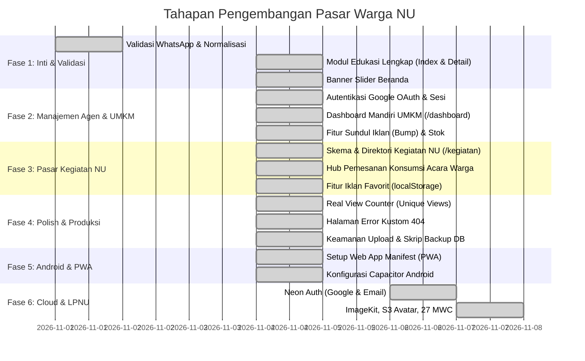

# Roadmap Pengembangan: Pasar Warga NU Sumenep (Mamasar)

Dokumen ini memetakan rencana kerja pengembangan aplikasi **Direktori Digital UMKM Nahdliyin Kabupaten Sumenep** menuju status aplikasi yang utuh, mandiri, dan siap skala operasional.

---

## 🧭 Prinsip Utama Arsitektur

1. **Nol Hambatan Operasional (Zero Operational Friction)**: UMKM tidak dibebani login, dashboard rumit, atau manajemen stok kompleks. Konversi 100% langsung via pesan WhatsApp terstruktur.
2. **Jemput Bola Agen Lapangan**: Pendataan digerakkan oleh kader lapangan MWC NU via portal cepat `/agen` dengan kompresi foto otomatis di sisi klien.
3. **Ekonomi Jamaah Nyata**: Mengintegrasikan kegiatan NU (pengajian, harlah, konferensi) sebagai pasar konsumsi (katering/snack berkat) dan lapak bazar warga.
4. **100% SEO-Friendly & Mobile-First**: Performa tinggi, data terstruktur Schema.org, Open Graph lengkap, dan waktu muat instan di jaringan pelosok.

---

## 📌 Status Pelaksanaan per Fase

---

## 📋 Rincian Pekerjaan & Checklist

### Fase 1: Kebutuhan Inti & Validasi Data (Target Selesai: Minggu 1) - [SELESAI ✅]
- [x] **1.1. Validasi Nomor WhatsApp & Normalisasi Otomatis**
  - [x] Regex validasi nomor HP Indonesia (`08xx`, `628xx`, panjang 10-14 digit) di `src/lib/utils.ts`.
  - [x] Validasi interaktif langsung pada form `src/pages/agen.astro`.
  - [x] Validasi ketat di endpoint API `src/pages/api/products.ts` (tolak nomor palsu).
- [x] **1.2. Modul Edukasi & Panduan Usaha Lengkap**
  - [x] Tambah kolom `content TEXT` pada tabel `articles` di `src/lib/db.ts`.
  - [x] Lengkapi konten artikel di `src/lib/seeds.ts` (Ekonomi Pekarangan, Panduan Usaha Santri, Legalitas Halal).
  - [x] Buat halaman katalog artikel `src/pages/edukasi/index.astro`.
  - [x] Buat halaman baca detail `src/pages/edukasi/[slug].astro` dengan Open Graph & Schema.org Article.
  - [x] Hubungkan card artikel di beranda dan navigasi drawer ke rute edukasi.
- [x] **1.3. Banner Slider Interaktif di Beranda**
  - [x] Buat komponen `src/components/PromoSlider.astro` (CSS scroll-snap murni, tanpa library berat).
  - [x] Isi slide: Kampanye Belanja Produk Tetangga, Sorotan Batik Tulis Sumenep, dan Konsultasi Usaha Santri.

---

### Fase 2: Autentikasi Google, Unggah Mandiri UMKM & Manajemen Iklan (Target Selesai: Minggu 2) - [SELESAI ✅]
- [x] **2.1. Autentikasi Google OAuth 2.0 & Profil Mandiri**
  - [x] Endpoint `/api/auth/login` (redirect Google OAuth + mode demo lokal).
  - [x] Endpoint `/api/auth/callback/google` (verifikasi profil Google & buat session cookie aman).
  - [x] Form lengkapi identitas toko bagi UMKM yang baru pertama kali login Google.
- [x] **2.2. Dashboard Toko Mandiri UMKM (`/dashboard`)**
  - [x] Tampilan ringkasan performa toko (nama toko, wilayah MWC, total produk aktif).
  - [x] Form tambah produk mandiri dengan kompresor foto HP otomatis di browser.
  - [x] Fitur edit produk, toggle status stok (*Tersedia / Habis*), dan hapus iklan.
- [x] **2.3. Fitur "Naikkan Iklan" (Sundul / Bump to Featured)**
  - [x] Tambah kolom `is_featured INTEGER DEFAULT 0` dan `bumped_at TIMESTAMP WITH TIME ZONE DEFAULT CURRENT_TIMESTAMP` di tabel `products`.
  - [x] Tombol **⚡ Sundul Iklan** di dashboard UMKM & endpoint `/api/products/bump` untuk mereset urutan tayang teratas.
  - [x] Urutan katalog default: `ORDER BY COALESCE(p.bumped_at, p.created_at) DESC, p.id DESC`.
- [x] **2.4. Portal Agen Lapangan & Sinkronisasi**
  - [x] Tetap sediakan form entri cepat jemput bola via login akun (`/agen`) untuk UMKM tradisional/sepuh.
  - [x] Penjual yang mendaftar via `/dashboard` dengan nomor WhatsApp yang sama ditawari mengambil alih toko hasil pendataan (`user_id` NULL) alih-alih membuat toko duplikat.
  - [x] Integrasi tautan Dashboard UMKM di header desktop dan drawer mobile.
  - [x] Halaman `/pengurus` untuk verifikasi toko pending: akun dengan `users.role = 'pengurus'` (dipromosi manual via SQL) bisa memberi/mencabut badge Verified dan menghapus toko spam.

---

### Fase 3: Pasar Kegiatan NU & Komunitas (Target Selesai: Minggu 3) - [SELESAI ✅]
- [x] **3.1. Direktori Kegiatan NU sebagai Hub Konsumsi & Pasar (`/kegiatan`)**
  - [x] Buat tabel `events` di SQLite (penyelenggara MWC/Banom, tanggal, lokasi, estimasi jamaah, catatan konsumsi, status lapak bazar).
  - [x] Buat halaman agenda kegiatan `src/pages/kegiatan/index.astro`.
  - [x] Buat halaman detail kegiatan `src/pages/kegiatan/[slug].astro` dengan:
    - [x] Tombol *"Pesan Konsumsi/Snack Acara dari UMKM MWC Ini"* (filter otomatis katering terdekat).
    - [x] Info pendaftaran lapak dagang bagi warga yang ingin jualan di lokasi acara.
- [x] **3.2. Fitur Simpan Iklan Favorit (Bookmark)**
  - [x] Handler interaktif tombol bintang ⭐ menyimpan ke `localStorage`.
  - [x] Halaman `src/pages/favorit.astro` untuk melihat daftar produk yang disimpan.
  - [x] Sinkronisasi instan state bintang di katalog, card produk, dan halaman detail produk.

---

### Fase 4: Polish Produksi & Keamanan (Target Selesai: Minggu 4) - [SELESAI ✅]
- [x] **4.1. Penghitung Pengunjung Riil (*Real View Counter*)**
  - [x] Fungsi aman `incrementProductViews(slug)` saat halaman `/p/[slug]` diakses dengan proteksi cookie debounce.
- [x] **4.2. Halaman Error 404 Kustom**
  - [x] Buat `src/pages/404.astro` seragam dengan identitas visual NU Sumenep.
- [x] **4.3. Hardening & Backup Otomatis**
  - [x] Validasi nomor telepon dan filter input di endpoint API.
  - [x] Skrip backup database SQLite atomik (`scripts/backup.js`) dan perintah `npm run backup`.

---

### Fase 5: Rilis Aplikasi Android (Capacitor) & PWA (Target: Pasca-Deploy Web) - [SELESAI ✅]
*Panduan lengkap: [`DOCS/ANDROID_CAPACITOR.md`](./DOCS/ANDROID_CAPACITOR.md)*
- [x] **5.1. Progressive Web App (PWA)**
  - [x] Pasang file `public/manifest.webmanifest` (nama app, icon logo NU, theme `#059669`).
  - [x] Daftarkan meta tags PWA di `src/layouts/Layout.astro` agar warga bisa "Add to Home Screen".
  - [x] Ikon SVG resolusi tinggi `public/icon.svg`.
- [x] **5.2. Pembungkusan Native Android via Capacitor (Hosted App Mode)**
  - [x] Buat file konfigurasi `capacitor.config.json` mengarah ke URL produksi domain resmi (`https://umkm.nusumenep.or.id`).
  - [x] Spesifikasi izin `AndroidManifest.xml` (Kamera HP untuk agen & intent query WhatsApp).
  - [x] Panduan instalasi dan kompilasi APK / AAB teruji di `DOCS/ANDROID_CAPACITOR.md`.

---

### Fase 6: Integrasi Cloud Neon & Fitur LPNU (Target: Setelah Deploy Web) - [SELESAI ✅]

- [x] **6.1. Neon Auth (Google dan Email/Password)**
  - [x] Endpoint `/api/auth/login` memakai Neon Auth `/sign-in/social` provider Google, plus mode demo `?demo=1`.
  - [x] Endpoint `/api/auth/email` untuk sign in dan sign up email/password.
  - [x] Callback `/api/auth/callback/neon`, sinkronisasi user ke tabel `users`, dan cookie `mamasar_session`.
  - [x] Resolver `resolveUser()` menerima sesi lokal atau cookie Neon Auth.
  - [x] Endpoint logout menghapus sesi lokal dan sesi Neon Auth.
  - [x] Endpoint `/api/auth/callback/google` dipertahankan untuk alur OAuth langsung (legacy).
- [x] **6.2. Media dan Object Storage**
  - [x] Foto produk ke ImageKit folder `/products` dengan fallback disk lokal dan route `/uploads/[...path]`.
  - [x] Foto profil ke Neon Object Storage bucket `assets` prefix `avatars/` dengan fallback disk lokal.
  - [x] Health check `/api/neon/services` untuk Postgres, object storage, functions, auth, dan realtime.
- [x] **6.3. Penyelarasan Data LPNU**
  - [x] 27 zona MWC: 18 daratan dan 9 kepulauan di `SEED_ZONES`.
  - [x] Kolom `shopee_url` pada produk dan input di dashboard.
  - [x] Tabel `cashbook` dan endpoint `/api/user/cashbook` untuk buku kas penjualan.
  - [x] Tautan referensi video lapangan di halaman edukasi.
- [x] **6.4. Deployment Vercel**
  - [x] Adapter Vercel otomatis saat `VERCEL` terisi, fallback ke adapter Node.
  - [x] Dokumentasi arsitektur dan variabel lingkungan diperbarui di `DOCS/INFRASTRUCTURE_VERCEL_NEON_IMAGEKIT.md`.
- [ ] **6.5. Migrasi CRUD ke Neon Postgres**
  - [ ] Pindahkan operasi baca/tulis dari `src/lib/db.ts` (SQLite) ke Neon Postgres agar data persisten di Vercel.
  - [ ] Sinkronkan `scripts/migrate-neon.js` dengan kolom `shopee_url` dan tabel `cashbook`.

Catatan cakupan: buku kas, manajemen stok, dan tautan Shopee berada di luar batas MVP yang ditulis di `Plan.md`. Fitur ini tetap dibangun karena mengikuti roadmap LPNU, dan statusnya dicatat di sini agar tidak dianggap bagian dari MVP awal.
